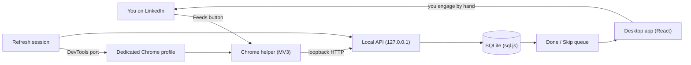

# LinkedIn Engagement Feed

Never miss a post from the LinkedIn people who matter most: a human-in-the-loop relationship CRM that builds your daily engagement queue and leaves the engaging to you.

> Built by **Satya Janghu**, a digital marketing expert specializing in SEO, AI search, and organic growth marketing. [getsatya.com](https://getsatya.com) · [satya@getsatya.com](mailto:satya@getsatya.com)


## Why it exists

Relationship-led growth on LinkedIn depends on showing up consistently for a short list of people: prospects, partners, clients and peers. LinkedIn's own feed buries their posts under everything else, so staying on top of even 50 people means opening profiles one by one and still missing posts. Done by hand, it costs time every day and leaves no record of who you have engaged with. LinkedIn Engagement Feed replaces all of that with one focused queue of new posts and comments from the people you track.

## What it does

- **Curated feeds.** Group up to 200 people per feed (for example "Agency Directors" or "SaaS Leaders"), each with its own lookback window (default 15 days, up to 365).
- **One-click tracking on LinkedIn.** A Chrome helper adds a `Feeds` button beside names on LinkedIn profiles, posts and activity pages. Bulk import takes pasted profile URLs or `Name, URL` lines and reports invalid rows.
- **Paced refresh.** A visible refresh walks each tracked person's posts and comments pages in a single tab and captures recent activity into your queue.
- **A Done / Skip work queue.** Status is global across feeds, so an item you handle once is handled everywhere. The `Done` and `Skipped` tabs let you reopen an accidental click.
- **Engagement counters.** Every `Done` increments a per-person counter, and reopening reverses it.
- **Local-first data.** Everything lives in a SQLite file on your machine, with rotating backups and a one-click JSON export.
- **Cross-platform.** Runs on macOS, Windows and Linux wherever Google Chrome or Chromium is installed.

**What it never does:** like, comment, message, connect or publish. All engagement is manual.

> **Responsible use:** you are responsible for complying with LinkedIn's User Agreement. The tool paces its requests, uses one visible tab, and uses no proxies or anti-detection techniques.

## How it works



1. **Track.** You browse LinkedIn in a dedicated Chrome profile that the desktop app launches. The helper extension adds `Feeds` controls beside names, so adding a person to a feed is one click.
2. **Refresh.** When you start a refresh, the app drives that Chrome profile over a local DevTools port. It opens each tracked person's posts and comments pages in turn, in one visible tab, with paced delays.
3. **Capture.** The helper captures visible activity, but only from people already tracked in the feed, and sends it to the app's loopback API. The API validates it, de-duplicates it and stores it in SQLite.
4. **Engage.** The desktop app shows the resulting queue. You open each item on LinkedIn, engage yourself, then mark it `Done` or `Skip`.

See [docs/ARCHITECTURE.md](docs/ARCHITECTURE.md) for the full component map, data model and limits.

## Engineering highlights

- **Crash-safe storage.** Saves go to a temp file and are atomically renamed into place. Every save also rotates a 3-generation backup chain. On startup the app recovers interrupted saves, runs a SQLite integrity check, falls back through the backups if needed, and quarantines corrupt files instead of deleting them.
- **Idempotent writes.** Every mutating request carries a `requestId`, and a replay returns the original result instead of applying twice. The client retries only safe calls: 3 attempts with 300 ms and 900 ms backoff, honoring `Retry-After` up to 5 s.
- **Adaptive pacing.** The delay between pages scales with feed size, from 2.8 s up to 3.6 s at 160+ people. Pages that don't load are retried after 6 s and 18 s. Text that looks like rate limiting ("too many requests", "unusual traffic") triggers cooldowns of 45 s, 90 s and 3 min.
- **Resumable sessions.** Refresh progress is persisted with 60 s heartbeats, so a run reconnects after an app restart. A stalled run expires after 45 minutes with a clear message, and a duplicate start reuses the active run.
- **Hardened loopback API.** It binds to `127.0.0.1` only and checks origins: LinkedIn pages reach only `/health` unless they send the app's identity header. It caps bodies at 1 MiB with a 12 s read timeout and validates inputs against strict schemas.
- **Self-checking Chrome integration.** The app reuses an existing controlled Chrome instead of spawning duplicates. It verifies over DevTools that the helper is live and on the expected version, and it gives clear recovery steps when recent Chrome builds ignore `--load-extension`.
- **Locked-down Electron.** A single-instance lock, `contextIsolation` on, `nodeIntegration` off, a four-method preload bridge, and clean shutdown of the API and database on quit.
- **Test suite.** 527 automated tests (`node:test`), including 301 database and API tests that run real sql.js databases against the real loopback HTTP server, plus contract tests for the UI, the Chrome helper and the API client.

## Tech stack

| Layer | Technology |
|---|---|
| Desktop shell | Electron 42 |
| UI | React 19, TypeScript 5.9, Vite 7, lucide-react |
| Storage | SQLite compiled to WebAssembly (sql.js 1.14) |
| Browser integration | Chrome Manifest V3 extension (plain JavaScript), Chrome DevTools Protocol |
| Local API | Node `http` server on loopback |
| Tests | Node `node:test` and `node:assert` (527 tests) |
| Tooling | concurrently, wait-on, cross-env |

## Project evolution

**Started as** a simple desktop app for keeping custom lists of LinkedIn people to stay engaged with. It had a capture helper and a manual Done / Skip queue.

**Became** a local-first relationship CRM with four cooperating parts: an Electron desktop app, a hardened loopback API, a Manifest V3 Chrome helper, and a resumable, paced refresh engine that drives a dedicated Chrome profile. Along the way it gained crash-safe storage, idempotent writes, cross-platform Chrome discovery and a 527-test suite, while keeping every act of engagement in human hands.

## Roadmap

- Packaged installers for macOS, Windows and Linux (today it runs from source).
- Per-person engagement history and reminders, such as "not engaged in 30 days".
- CSV import and export alongside the JSON export.
- Tags and notes per person.
- Queue analytics: done and skip rates per feed over time.
- Optional scheduled refresh windows.

## Running it locally

**Prerequisites:** Node.js 20.19+ (built and tested on Node 24), npm and Google Chrome.

```bash
npm install
npm run build
npm start        # run from the repo root
```

- `npm run dev` starts Vite on `127.0.0.1:5173`, the TypeScript watcher and Electron together.
- `npm test` builds the app, then runs the full test suite.
- No API keys or `.env` file are needed. Optionally, set `LINKEDIN_FEED_USER_DATA_DIR` to choose where the SQLite database and Chrome profile are stored; by default they go in Electron's user data directory.

In the app, click `Open LinkedIn Workspace` and sign in to LinkedIn in the dedicated profile. If the `Feeds` buttons don't appear, open `chrome://extensions`, enable Developer mode, and load the `chrome-extension/` folder with `Load unpacked`.

## Documentation

- [Architecture](docs/ARCHITECTURE.md): components, data model, limits, storage safety, refresh pacing and API hardening.

## About the author

> Built by **Satya Janghu**, a digital marketing expert specializing in SEO, AI search, and organic growth marketing. [getsatya.com](https://getsatya.com) · [satya@getsatya.com](mailto:satya@getsatya.com)

Satya takes the busywork out of social selling, like tracking who posted what, so the conversations themselves can stay personal.

## License

All rights reserved. See [LICENSE](LICENSE).
